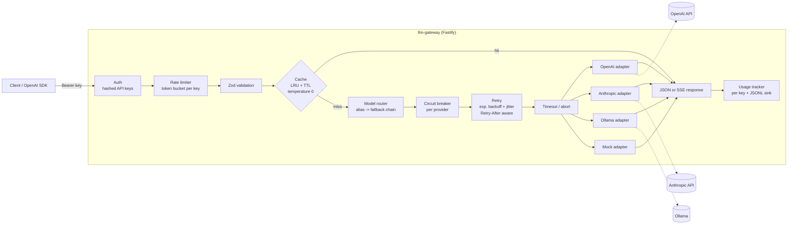
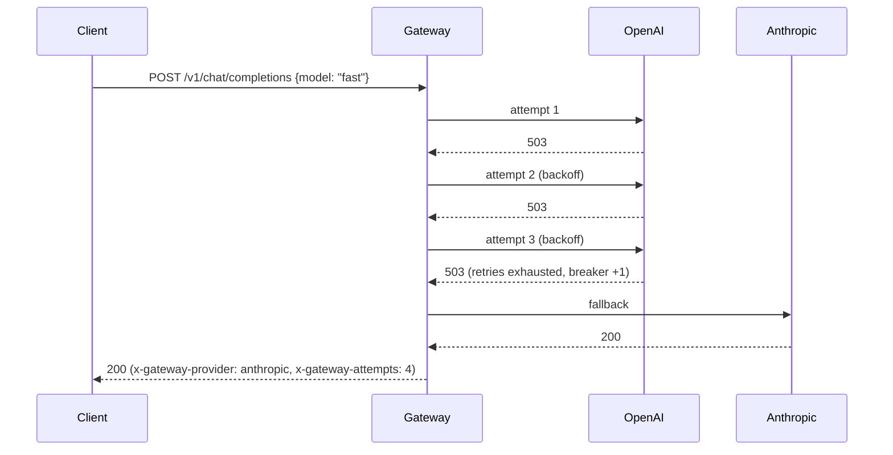

# llm-gateway

[](https://github.com/hakim86dev-eng/llm-gateway/actions/workflows/ci.yml)


An **OpenAI-compatible LLM API gateway** written in strict TypeScript on Fastify. You point any
OpenAI SDK at it, and it handles **provider routing (OpenAI, Anthropic, Ollama)**, **retries with
backoff**, **automatic fallback**, **circuit breaking**, **response caching**, **per-key rate
limiting**, **SSE streaming** and **usage accounting**. It also serves auto-generated
**OpenAPI docs**.

```ts
import OpenAI from 'openai';
const client = new OpenAI({ apiKey: 'sk-gw-demo-change-me', baseURL: 'http://localhost:8080/v1' });
await client.chat.completions.create({
  model: 'fast',
  messages: [{ role: 'user', content: 'Hi' }],
});
```

The snippet above has been tested end-to-end with the official `openai` Node SDK, for both
non-streaming and streaming calls, `models.list()`, and its handling of 429 responses.

## Architecture



**Fallback flow.** A failing target is retried first. Once its retry budget is spent, the request
moves on to the next target. Bad requests (400) are surfaced without falling back.



## Features

| Area                      | What it does                                                                                                                                                                                                                                                                 |
| ------------------------- | ---------------------------------------------------------------------------------------------------------------------------------------------------------------------------------------------------------------------------------------------------------------------------- |
| **OpenAI-compatible API** | `POST /v1/chat/completions` (JSON and `stream: true` SSE) and `GET /v1/models`. Errors use OpenAI's `{error: {message, type}}` shape, so existing SDKs and tools work unchanged.                                                                                             |
| **Provider adapters**     | OpenAI (and any OpenAI-compatible API), Anthropic Messages API (system-prompt mapping, required `max_tokens`, event-stream parsing), Ollama (`/api/chat`, NDJSON streaming), and an offline mock provider.                                                                   |
| **Routing**               | Aliases expand to ordered fallback chains (`fast`, `smart`, `local`, `demo`, or your own via `MODEL_ROUTES`). Also accepts explicit `provider/model` or a bare `gpt-*` / `claude-*` name. Unconfigured providers are skipped.                                                |
| **Resilience**            | Exponential backoff with full jitter that honours `Retry-After`. Per-attempt timeouts. A per-provider **circuit breaker** (closed, open, half-open) skips a failing provider immediately. Error classification decides between retrying, falling back and failing fast.      |
| **Streaming**             | SSE in OpenAI chunk format, ending with `[DONE]`. Retries and fallback happen _before the first token_, so a failure at that stage still returns a proper JSON error. A failure mid-stream produces an SSE error event, and a client disconnect aborts the upstream request. |
| **Caching**               | An LRU cache with TTL and SHA-256 keys built from a normalised request. Only `temperature: 0` requests are cached, and `Cache-Control: no-cache` bypasses the cache. Responses carry an `x-cache: HIT/MISS` header.                                                          |
| **Auth & rate limits**    | Bearer or `x-api-key` auth. Keys are stored only as SHA-256 digests and compared in constant time. A per-key token bucket returns `x-ratelimit-*` headers, plus `429` and `Retry-After` when the limit is hit.                                                               |
| **Usage**                 | Per-key aggregation (requests, errors, cache hits, prompt/completion tokens, breakdown by model) at `GET /v1/usage`, with an optional JSONL sink. Cached responses aren't billed.                                                                                            |
| **Ops**                   | `/health` reports circuit and cache status. Swagger UI is at `/docs` and the OpenAPI JSON at `/docs/json`. Logs are structured pino with auth headers redacted, `x-request-id` is propagated, and the server shuts down gracefully.                                          |
| **Quality**               | Strict TypeScript (`noUncheckedIndexedAccess` and more), the `strictTypeChecked` typescript-eslint preset, Prettier, **57 Vitest tests at about 98% line coverage**, and a multi-stage non-root Docker image with a healthcheck.                                             |

## Quickstart

```bash
npm ci
cp .env.example .env          # ENABLE_MOCK_PROVIDER=true works without any provider key
npm test                      # 57 tests, all upstream calls mocked
npm run dev                   # http://localhost:8080/docs
```

Docker:

```bash
docker compose up --build                     # gateway on :8080 with the mock provider
docker compose --profile ollama up -d         # optional local models (set OLLAMA_BASE_URL=http://ollama:11434)
```

Add real providers by setting `OPENAI_API_KEY`, `ANTHROPIC_API_KEY` and/or `OLLAMA_BASE_URL`. A
provider is enabled only when it's configured.

## API examples

```bash
KEY=sk-gw-demo-change-me

# Non-streaming, routed through the "fast" fallback chain
curl -s localhost:8080/v1/chat/completions -H "authorization: Bearer $KEY" \
  -H 'content-type: application/json' \
  -d '{"model": "fast", "temperature": 0, "messages": [{"role": "user", "content": "What is RAG?"}]}' -i
```

```http
HTTP/1.1 200 OK
x-ratelimit-limit: 60
x-ratelimit-remaining: 59
x-gateway-provider: openai
x-gateway-model: gpt-4o-mini
x-gateway-attempts: 1
x-cache: MISS
```

```json
{
  "id": "chatcmpl-...",
  "object": "chat.completion",
  "model": "openai/gpt-4o-mini",
  "choices": [
    { "index": 0, "message": { "role": "assistant", "content": "..." }, "finish_reason": "stop" }
  ],
  "usage": { "prompt_tokens": 12, "completion_tokens": 48, "total_tokens": 60 },
  "gateway": { "provider": "openai", "cached": false, "attempts": 1 }
}
```

```bash
# Streaming (SSE)
curl -N localhost:8080/v1/chat/completions -H "authorization: Bearer $KEY" \
  -H 'content-type: application/json' \
  -d '{"model": "anthropic/claude-sonnet-4-5", "stream": true, "messages": [{"role": "user", "content": "Hi"}]}'
# data: {"object":"chat.completion.chunk","choices":[{"delta":{"content":"Hel"}, ...}]}
# data: {"object":"chat.completion.chunk","choices":[{"delta":{},"finish_reason":"stop"}],"usage":{...}}
# data: [DONE]

# Models (aliases and their available targets) and usage for your key
curl -s localhost:8080/v1/models -H "authorization: Bearer $KEY"
curl -s localhost:8080/v1/usage  -H "authorization: Bearer $KEY"
```

| Method | Path                   | Auth | Purpose                                         |
| ------ | ---------------------- | ---- | ----------------------------------------------- |
| POST   | `/v1/chat/completions` | ✓    | Chat completion (JSON or SSE)                   |
| GET    | `/v1/models`           | ✓    | Aliases and their routed targets                |
| GET    | `/v1/usage`            | ✓    | Usage for the calling key                       |
| GET    | `/health`              | –    | Liveness, circuit states, cache stats           |
| GET    | `/docs`                | –    | Swagger UI (OpenAPI generated from Zod schemas) |

## Configuration

All configuration comes from environment variables validated by Zod at startup, and the gateway
fails fast with a readable error. See [`.env.example`](.env.example). The main ones are:

- `GATEWAY_API_KEYS`: `name:key[:rpm]` entries separated by commas, e.g. `web:sk-gw-...:120,batch:sk-gw-...:600`
- `MODEL_ROUTES`: JSON mapping each alias to its fallback chain, e.g. `{"fast": ["openai/gpt-4o-mini", "ollama/llama3.1"]}`
- `MAX_RETRIES`, `RETRY_BASE_DELAY_MS`, `RETRY_MAX_DELAY_MS`, `REQUEST_TIMEOUT_MS`
- `CIRCUIT_FAILURE_THRESHOLD`, `CIRCUIT_COOLDOWN_MS`, `CACHE_TTL_SECONDS`, `CACHE_MAX_ENTRIES`, `USAGE_LOG_PATH`

## Project layout

```
src/
  config.ts            env parsing & validation (zod)
  types.ts, errors.ts  provider-neutral types; ProviderError (retryable/fallbackable) & GatewayError
  providers/           openai, anthropic, ollama, mock adapters + SSE/NDJSON parsers + HTTP helper
  core/                router, retry, circuit breaker, cache, rate limiter, auth, usage, gateway pipeline
  http/                Fastify app, routes, zod schemas -> OpenAPI
  server.ts            entry point with graceful shutdown
test/                  unit tests + Fastify inject integration tests with a fake fetch
```

## Design decisions

- **Speak OpenAI's protocol at the edge.** Every SDK, LangChain integration and tool already speaks it, so adopting the gateway means changing a base URL. Each adapter translates between OpenAI's format and its provider's native one.
- **Error classification drives behaviour.** Each upstream error becomes a `ProviderError` with `retryable` (timeouts, 408/409/429/5xx, network failures) and `fallbackable` (retryable errors, plus 401/403/404, which indicate a provider configuration problem). A 400 means the request itself is bad, so it fails fast instead of being sent to every provider.
- **Streaming commits at the first token.** Before the first token, failures are invisible to the client because the gateway can still retry or fall back. After it, replaying a stream on another model would produce inconsistent text, so the gateway reports an in-band SSE error instead.
- **Cache only what's deterministic.** Caching `temperature > 0` responses would quietly change semantics. Keys are hashes of a normalised request, so key order doesn't matter and no prompt text ends up in key names.
- **No plaintext secrets at rest in memory maps.** Gateway keys are kept as SHA-256 digests and compared with `timingSafeEqual`, and logs redact auth headers.
- **Dependency injection for testability.** `fetch`, the clock, `sleep` and `random` are all injectable, so the tests exercise real HTTP mapping, backoff, circuit timing and rate-limit refill deterministically, without network access or real API keys.
- **Single-instance state, swappable seams.** The rate limiter, cache, circuit breakers and usage aggregates live in memory, which is the right default for a single instance. Each one sits behind a small class, so moving it to Redis or Postgres for horizontal scaling is a contained change.

## Limitations and roadmap

- Only text chat is supported for now: no tool or function calling passthrough, embeddings or images.
- State (rate limits, cache, usage) lives in memory per instance. Redis-backed implementations are the natural next step.
- Usage is token-based. Per-model cost tables and budgets would come next.

## License

[MIT](LICENSE) © 2026 Hakim Rashid
